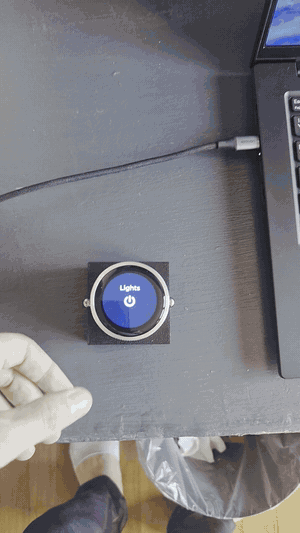
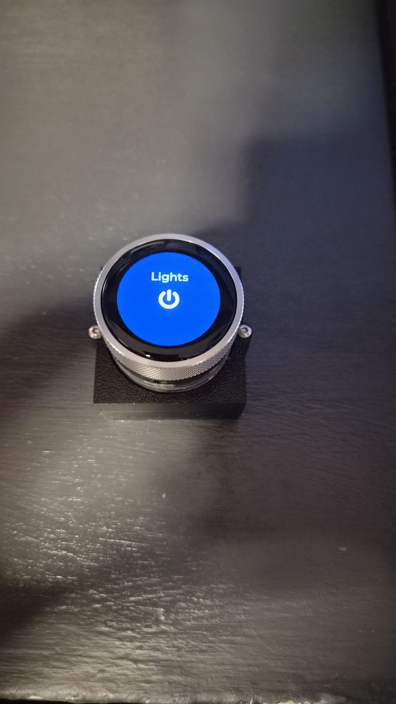
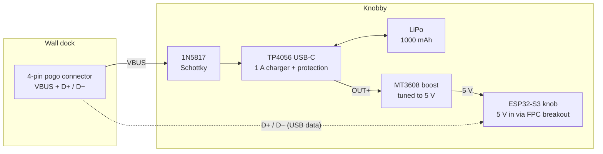
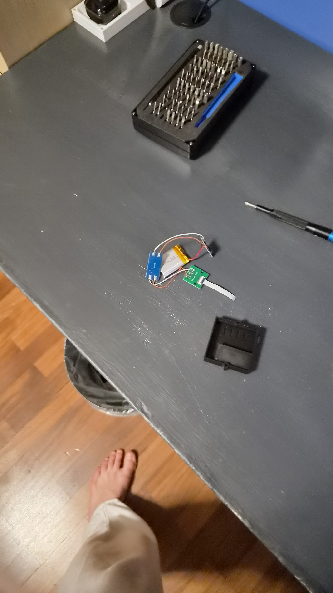
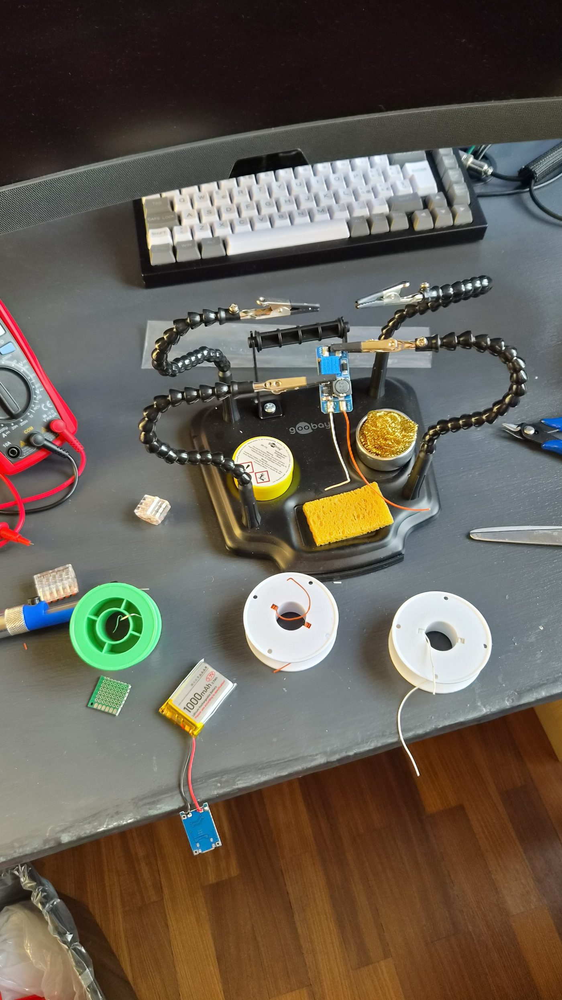
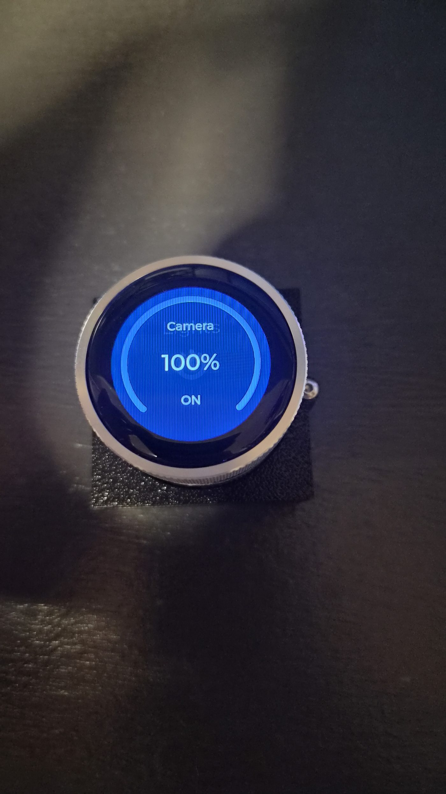

# Knobby

**A palm-sized, battery-powered smart knob for Home Assistant.**

Rotate to dim the lights, click to toggle relays, wake the PC over LAN — all from a knurled aluminum knob with a round touchscreen that lives on a magnetic wall dock and runs for weeks on a single charge.

Built on an **ESP32-S3** with **ESPHome** and **LVGL**. No custom app, no cloud: it talks to Home Assistant over the native API.

<p align="center">
  
  &nbsp;&nbsp;
  
</p>

## Features

- **Rotary + touch UI** on a 1.28″ round LCD (GC9A01A, 240×240) — rotate to navigate and adjust, click to select, double-click to go back, touch to wake
- **Live light dimming** with a circular brightness arc that tracks the ring in real time
- **Relay control** (3D printer, camera, PC power) and **Wake-on-LAN** with live online/offline status
- **Fully wireless**: 1000 mAh LiPo, USB-C charging, plus a 4-pin pogo dock that charges it on the wall
- **Two-stage power saving**: backlight off after 30 s, true deep sleep after 60 s (~10 µA on the ESP32 — weeks of standby, not hours); a screen tap wakes it back up
- **Snappy under load**: coalesced rendering, throttled API pushes and echo-guarded state sync keep the ring lag-free (details below)

## How it works

```
Main menu ──► Lights ──► Desk / Camera / Bed ──► detail: arc + % + ON/OFF
         ├──► Relays ──► 3D printer / Camera / PC ──► detail: toggle
         └──► WOL    ──► wake PC, live ping status
```

| Gesture | Action |
|---|---|
| Rotate | Move through menus / adjust brightness |
| Single click | Select / toggle |
| Double click | Back |
| Touch the glass | Wake from standby or deep sleep |

## Hardware

| Part | Role |
|---|---|
| ESP32-S3 knob module (round GC9A01A 240×240 LCD, CST816 touch, push-button rotary encoder, octal PSRAM) | Brains + UI |
| TP4056 USB-C module (1 A, with protection) | LiPo charging + battery protection |
| LiPo 1000 mAh | Battery |
| MT3608 boost converter, tuned to 5 V | Battery → 5 V rail for the knob |
| 1N5817 Schottky diode | Dock input protection |
| 4-pin pogo connector (VBUS + D+/D−) | Wall-dock charging + USB data pass-through |
| 3D-printed enclosure + wall dock | Body |

### Power architecture

The original wiring schema was designed in [Figma](https://www.figma.com/board/tWYULR0jQmhHcf52yjzOwT/Crow-Panel-Schema); this is the equivalent diagram:



The TP4056's own USB-C port still works for charging off the dock. In deep sleep the ESP32 drops to ~10 µA; what remains is mostly the MT3608's quiescent draw (~1–2 mA total).

## Firmware highlights

The whole device is a single, heavily commented ESPHome config — [`knobby.yaml`](knobby.yaml) — but a few parts required real tuning:

- **Coalesced rendering.** Input events don't redraw the screen directly; they set a dirty flag that a 40 ms interval consumes. A fast spin of the ring costs one redraw instead of dozens queued in the main loop.
- **Keyed re-render.** The detail page computes a signature (light + state + %) and skips LVGL updates entirely when nothing changed — no widget invalidation, no redraw.
- **Echo guard.** After a local brightness change, state echoes from Home Assistant are ignored for 2.5 s — otherwise the fade transition's intermediate values bounce the arc around while you're still turning.
- **Leading-edge throttle.** Brightness follows the ring in real time locally, but pushes to HA at most every 250 ms instead of a burst of API calls per detent.
- **Blocking-log fix.** ESPHome writes logs to UART synchronously (~9 ms per line at 115200 baud). The encoder's per-detent state logs alone were enough to make the ring lag — hot tags are silenced selectively instead of lowering the global log level.
- **Encoder resolution.** `resolution: 1` counts one full quadrature cycle per physical detent; the default counted every edge, producing 4 events per click that drifted out of phase with the mechanical detents.
- **Deep-sleep GPIO holds.** On boot, held GPIOs from the previous sleep are released *before* component init (priority 800), otherwise display/touch initialize against frozen pins.
- **Wake-pin sharing.** On the S3 only GPIOs 0–21 can wake from deep sleep, so the encoder (41/42/45) can't. The CST816 touch interrupt (GPIO5) doubles as the wake pin, with `KEEP_AWAKE` mode to avoid instant re-wake when the INT line is still active.
- **Static IP.** Home Assistant runs in WSL2, where mDNS multicast doesn't cross the NAT — a DHCP lease change would leave the device permanently "unavailable", so it pins its own IP.

## Lessons learned the hard way

- A bare TP4056 USB-C module has no CC resistors, so **C-to-C cables silently don't charge it** — a USB-A→C cable works fine.
- The first firmware's "standby" only switched the backlight off while everything else kept drawing ~200 mA. The battery over-discharged to ~2.8 V and never recovered (charges to full, dies in minutes). That incident is why the current firmware has *real* deep sleep — and why the charger module has protection.

## Getting started

1. Install [ESPHome](https://esphome.io) and clone this repo.
2. Copy `secrets.example.yaml` to `secrets.yaml` and fill in your Wi-Fi credentials and keys.
3. Adjust the Home Assistant entity IDs in `knobby.yaml` (lights, switches, WOL button, ping sensor) to match your setup, and check the `manual_ip` block against your network (or remove it if mDNS works for you).
4. Flash: `esphome run knobby.yaml` (first flash over USB, then OTA).

> The ESPHome node is named `portable-knob` — Knobby's original working title — so it appears in Home Assistant as "Portable Knob". Rename the substitutions at the top of the YAML if you prefer.

## Build

<p align="center">
  
  &nbsp;&nbsp;
  
  &nbsp;&nbsp;
  
</p>

Parts were sourced from AliExpress and Amazon — links from my build notes:
[AliExpress 1](https://it.aliexpress.com/item/1005009635476640.html) ·
[AliExpress 2](https://it.aliexpress.com/item/1005009774001246.html) ·
[AliExpress 3](https://it.aliexpress.com/item/1005011528926543.html) ·
[Amazon](https://www.amazon.it/dp/B0DPZLNQ2C)

## License

[MIT](LICENSE) © Mattia Longobardo — [longobardo.me](https://longobardo.me)
